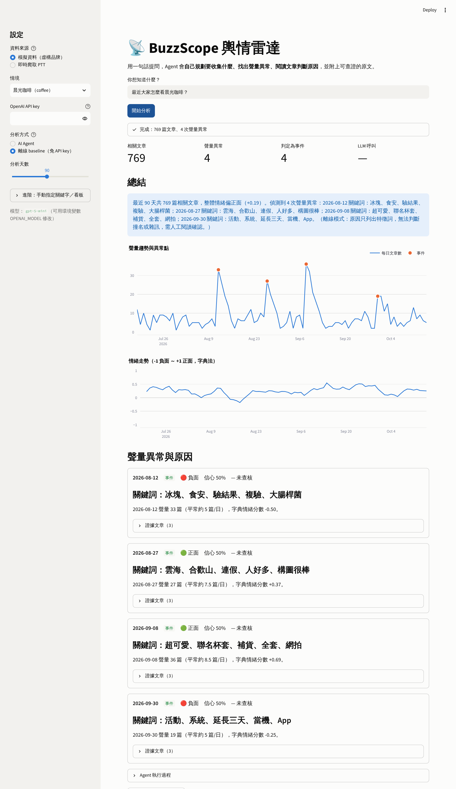
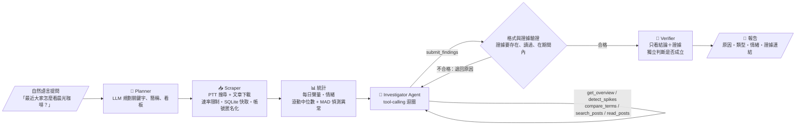
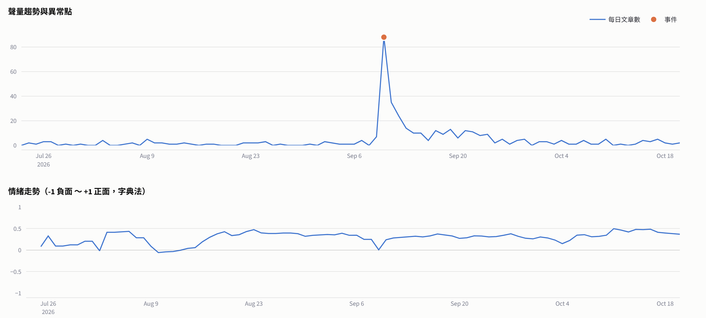
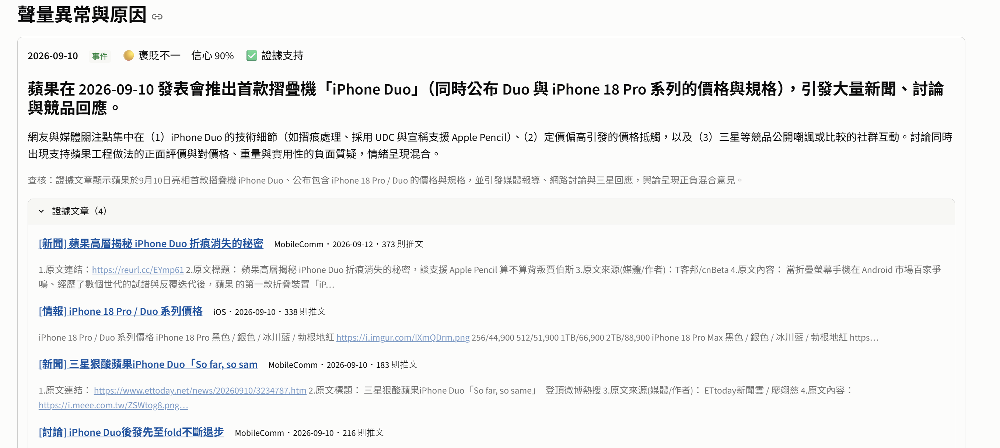

# 📡 BuzzScope 輿情雷達

**用一句話提問，AI Agent 會自己規劃要爬什麼、找出聲量異常、閱讀文章判斷原因，並附上可查證的原文。**

> 問「最近大家怎麼看晨光咖啡？」（虛構品牌的模擬資料），標準答案是：8/12 聲量暴增約 5 倍，原因是衛生局抽驗冰塊大腸桿菌超標，負面；8/27 的暴增其實是合歡山「晨光」攝影文，與品牌無關；9/8 動畫聯名杯套秒殺，正面⋯⋯Agent 要自己把這些找出來。


English summary: *BuzzScope is a social-listening agent for Taiwan's PTT forum. From a natural-language question it plans keywords and boards, scrapes politely, detects volume spikes with a robust statistical baseline, and runs a tool-calling LLM agent that reads the posts to explain each spike — including telling real events apart from keyword collisions and noise. Findings must cite posts the agent actually read, and an independent verifier checks them. Evaluated on synthetic datasets with planted ground truth.*

---

## 為什麼做這個

品牌、公關、行銷團隊都想知道「網路上大家怎麼看我們」。市面上的輿情監測服務能告訴你**聲量多少、正負面比例**，但最關鍵的問題通常還是要靠分析師人工回答：

- **為什麼**某天聲量突然暴增？
- 這波討論**真的在講我們嗎**？（品牌名撞到一般詞彙是常態）
- 結論的**證據**在哪？

BuzzScope 把這段人工流程交給 Agent：統計方法負責「發現異常」，LLM 負責「讀文章、找原因、判斷是否撞名」，每個結論都要附上它讀過的原文，並經過獨立查核。

## Demo



> 上圖為離線 baseline 模式（免 API key）。Agent 模式會把「撞名」和「正常波動」標出來，並寫出完整的原因說明。

## 運作方式



**每個聲量異常會被判斷成三種類型之一：**

| 類型 | 意思 | 例子 |
|---|---|---|
| `event` | 與品牌有關的具體事件 | 食安新聞、聯名活動、App 當機 |
| `unrelated` | 關鍵字撞名，其實不是在講這個品牌 | 「晨光」= 日出攝影；「雲豹」= 保育類動物 |
| `noise` | 找不到共同事件，只是正常波動 | 剛好某天文章比較多 |

這是純統計或關鍵字方法做不到、但對實際使用者最重要的判斷。

## 快速開始

### 方法 1：Docker（最簡單）

```bash
git clone https://github.com/jessalyn-92/buzzscope.git
cd buzzscope
cp .env.example .env          # 要用 Agent 模式就填入 OPENAI_API_KEY；只看離線 demo 可以不填
docker compose up --build
```

打開 http://localhost:8501

### 方法 2：本機 Python

macOS / Linux：

```bash
python -m venv .venv
source .venv/bin/activate
pip install -e ".[dev]"
cp .env.example .env
streamlit run src/buzzscope/app/streamlit_app.py
```

Windows（PowerShell）：

```powershell
python -m venv .venv
.venv\Scripts\Activate.ps1
# 若出現「已停用指令碼執行」：Set-ExecutionPolicy -Scope CurrentUser -ExecutionPolicy RemoteSigned
pip install -e ".[dev]"
copy .env.example .env
streamlit run src/buzzscope/app/streamlit_app.py
```

### 方法 3：命令列

```bash
# 離線 demo（不需要 API key、不需要網路）
buzzscope analyze "最近大家怎麼看晨光咖啡？" --source synthetic:coffee --mode baseline

# AI Agent 分析模擬資料
buzzscope analyze "最近大家怎麼看晨光咖啡？" --source synthetic:coffee --mode agent

# AI Agent 即時爬 PTT（Agent 會自己決定關鍵字與看板）
buzzscope analyze "最近大家怎麼看 iPhone 17？" --source ptt --mode agent --days 30

# 評估
buzzscope eval --mode baseline
buzzscope eval --mode agent
```

## 設計重點

**1. 統計找異常，LLM 找原因：各做擅長的事。**
「哪天聲量異常」是統計問題，用 LLM 判斷既貴又不穩定。異常偵測用過去 14 天的**滾動中位數 + MAD**，而不是平均數 + 標準差，因為暴增本身會把平均數和標準差拉高，讓後面幾天的異常被「吃掉」；中位數不受單日極端值影響。LLM 只處理統計做不到的事：閱讀、理解、判斷。

**2. Agent 不能空口說白話。**
`submit_findings` 會被程式驗證：證據文章必須存在、必須是 Agent 用 `read_posts` **真的讀過**的、日期必須落在該次異常期間內，而且每次偵測到的異常都要有結論。不合格就把錯誤原因退回給 Agent 重做（最多兩次）。這把「幻覺」從不可控的問題，變成可以用程式擋下的規則。

**3. 獨立查核（Verifier）。**
另一次 LLM 呼叫只看「結論 + 證據原文」，看不到 Agent 的推理過程，所以不會被說服，只判斷證據是否支持結論。不成立的結論會保留但標示 ⚠️，讓使用者自己判斷。

**4. 撞名是預期中的，而且要被抓出來。**
規劃器會刻意加入品牌簡稱（「晨光咖啡」→「晨光」），因為網友真的這樣寫；代價是會撈到無關文章。與其用排除字典硬擋（擋不完，還會誤殺），不如讓 Agent 讀文章時判斷。

**5. 成本與效率。**
趨勢圖的情緒用免費的字典法加上推/噓計算；只有在異常點才讓 LLM 讀文章，每篇截斷到 500 字。工具輸出都經過精簡，最後一步強制呼叫 `submit_findings`，避免 Agent 無限繞圈。

**6. 爬蟲禮貌與隱私。**
預設每次請求間隔 1 秒、遇到 429/5xx 指數退避、單執行緒；文章快取在 SQLite，重跑不重爬；PTT 帳號在儲存前就換成加鹽雜湊。

## Eval：怎麼知道它分析得對？

真實資料沒有標準答案，所以我建了 **3 個虛構品牌、各 90 天的模擬資料集**（`src/buzzscope/synthetic/scenarios.py`），裡面埋了 **9 個真實事件** 和 **2 個撞名干擾**，也刻意放了 PTT 常見的**反串**留言（例如「感謝漲價，讓我戒手搖成功」）。每篇文章都帶有隱藏標籤，Agent 的工具絕對不會輸出這些標籤（有單元測試保證），評估時才拿來對答案。

| 指標 | 意義 |
|---|---|
| 事件召回率 | 埋設事件有被找到並判斷為 event 的比例 |
| 事件精確率 | 判斷為 event 的結論中，真的是埋設事件的比例（撞名或雜訊被當成事件會扣分） |
| 撞名排除率 | 撞名干擾**沒有**被當成品牌事件的比例 |
| 原因正確率 | 原因描述有說中埋設的原因 |
| 情緒正確率 | 情緒判斷正確（反串會讓字典法出錯） |
| 證據精確率 | 引用的證據文章真的屬於該事件 |

### 結果

Agent 使用 `gpt-5-mini`，3 個情境共 36 次 LLM 呼叫（輸入約 8.2 萬 tokens、輸出約 1.7 萬 tokens）。

| 指標 | 離線 baseline | AI Agent |
|---|---|---|
| 事件召回率 | 100% | 100% |
| 事件精確率 | 82% | **100%** |
| 撞名排除率 | **0%** | **100%** |
| 原因正確率 | 100%* | 100% |
| 情緒正確率 | 89% | 89% |
| 證據精確率 | 100% | 100% |

完整逐事件結果：[`eval/results/baseline.md`](eval/results/baseline.md)、[`eval/results/agent.md`](eval/results/agent.md)

**怎麼解讀：**
- **最大的差別是撞名判斷。** baseline 把「合歡山晨光攝影」和「臺灣雲豹保育」都報成品牌事件（撞名排除率 0%）；Agent 讀完文章後兩個都正確判為 `unrelated`，事件精確率因此從 82% 提升到 100%。這是只靠關鍵字統計做不到、而 Agent 能做到的事。
- **兩者都答錯同一題情緒：拾光茶飲漲價。** 這個事件刻意混入大量反串推文（「推佛心公司 漲得好」「感謝幫我戒糖 太讚了」），標準答案是負面。字典法被正面詞騙到，Agent 也沒有完全識破。反串仍是這個系統目前最明確的弱點，也是下一步要改進的方向。
- *召回率與原因正確率兩者都是 100%，主要是因為模擬資料的事件用詞集中、容易辨識，**不代表在真實資料上也能達到這個水準**。
- 樣本數很小（9 個事件、2 個撞名），而且 LLM 每次輸出不完全相同，這份結果是單次執行的成績，應視為「功能驗證」，而不是精確的效能數字。

### 真實資料執行結果

問「最近大家怎麼看 iPhone？」，Agent 即時爬取 PTT，偵測到 2026-09-10 的聲量暴增，並自行閱讀文章，判斷原因是 Apple 發表首款摺疊機 iPhone Duo，與實際新聞一致。這份資料沒有標準答案，結果是人工對照新聞與證據文章確認的。




## 資料與倫理

- 本 repo **不包含任何真實爬取的資料**。PTT 文章的著作權屬於原作者，帳號屬於個人資料；`data/` 已列入 `.gitignore`。
- 模擬資料中的品牌（晨光咖啡、拾光茶飲、雲豹手機）與事件**全部虛構**，避免對真實企業產生不實指控。
- 爬蟲僅存取公開頁面，遵守速率限制。請勿調高頻率或用於騷擾、監控特定個人。

## 已知限制

- PTT 網頁版搜尋只比對**標題**，內文提到但標題沒提的文章會漏抓。
- 字典法情緒只作為趨勢參考；Agent 對每個異常的情緒是讀文章後判斷的，但 Agent 本身也可能出錯，因此有 Verifier 和證據連結讓人查核。
- 模擬資料的事件用詞較集中，比真實資料容易；未來會加入人工標註的真實事件作為第二組評估。
- 反串（例如「感謝漲價」）仍會造成情緒誤判，字典法與 Agent 在 eval 中都答錯了這一題。
- 目前只支援 PTT；Dcard 等來源只要實作 `Source` 介面（`fetch(plan) -> list[Post]`）即可加入。

## 專案結構

```
src/buzzscope/
├── agent/
│   ├── planner.py        # 問題 → 研究規劃（LLM / 規則備援）
│   ├── tools.py          # Agent 可呼叫的 6 個工具 + submit 驗證
│   ├── investigator.py   # tool-calling 迴圈
│   ├── verifier.py       # 獨立查核
│   └── llm.py            # OpenAI client + 測試用的 ScriptedLLM
├── analysis/
│   ├── volume.py         # 每日序列、MAD 異常偵測
│   ├── keyness.py        # 中文特徵詞（n-gram log-odds，不需斷詞套件）
│   ├── sentiment.py      # 字典 + 推噓情緒
│   └── baseline.py       # 無 LLM 的對照組
├── scraper/              # PTT 爬蟲、HTML 解析、模擬資料來源
├── synthetic/            # 模擬情境（含埋設事件）與產生器
├── evaluation.py         # 指標計算
├── pipeline.py           # 串起整個流程
├── cli.py                # buzzscope 指令
└── app/                  # Streamlit 儀表板
tests/                    # 解析器、統計、Agent 迴圈（不需 API key）
eval/results/             # 評估結果
```

## Roadmap

- [ ] 人工標註 30 個真實 PTT 事件，作為第二組評估
- [ ] 加入 Dcard 資料來源
- [ ] 排程監控：每天自動跑一次，偵測到新異常時推播（LINE / Email）
- [ ] 改善反串偵測（例如在 prompt 中加入反串判斷步驟，並擴充反串測試案例）
- [ ] 比較不同模型的準確率與成本
- [ ] 同一 eval 重複執行多次，回報平均與變異

## License

MIT
